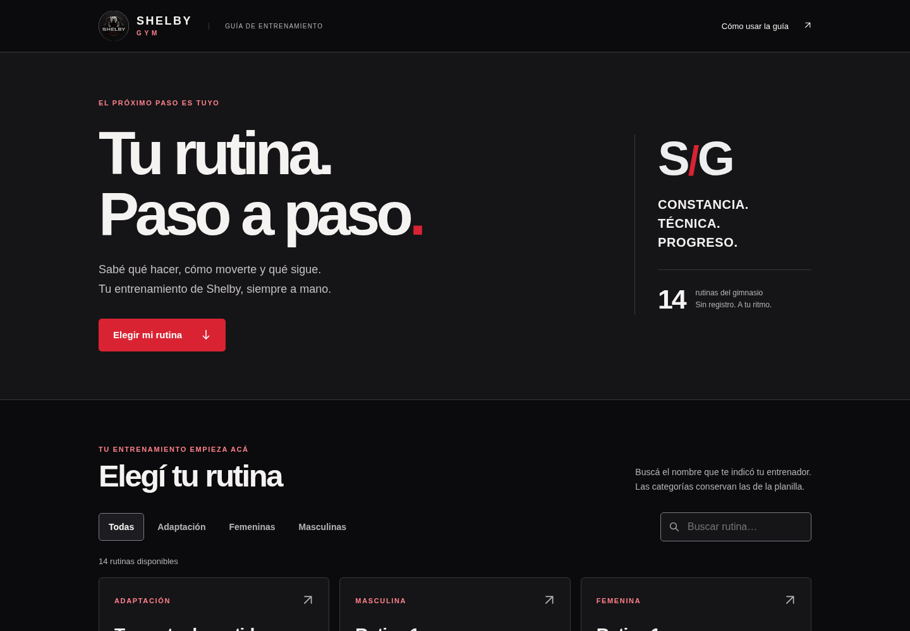

# Shelby Gym · Rutinas

Web pública estática, independiente de la administración. Incluye las **14 rutinas,
40 días/sesiones y 301 entradas de ejercicios** de `RUTINAS.pdf`, con la clasificación,
orden y dosis originales. Sin registro, backend, base de datos ni dependencias de producción.

La navegación, las demostraciones disponibles y el avance local funcionan. **La cobertura
visual todavía no es total**: ver `docs/MEDIOS_PENDIENTES.json` y las preguntas de
`docs/REVISION_ENTRENADOR.md`. No se inventan descansos ni variantes sin definir.
El código de esta vista previa está en la rama `main` del repositorio independiente.
**[Abrir la web navegable](https://calderondante.github.io/Shelby-Gym-Rutinas/) · [Probar la rutina de adaptación](https://calderondante.github.io/Shelby-Gym-Rutinas/?rutina=rutina-de-adaptacion-para-hombres-y-mujeres&dia=sesion)**

GitHub Pages confirmó la publicación de la vista previa. [Despliegue correcto](https://github.com/calderondante/Shelby-Gym-Rutinas/actions/runs/40587339073).
Netlify continúa disponible como opción separada; no se modificó la administración.

## Vista previa



[Captura móvil de un ejercicio](docs/qa/current/ejercicio-390.png) ·
[Vista en los cinco tamaños](docs/qa/current/responsive-catalogo.jpg)

El repositorio muestra el código y las capturas. La vista previa navegable se prepara en GitHub Pages desde `gh-pages`; Netlify sigue
disponible como despliegue independiente usando `public/`.

## Ejecutar y comprobar

Requisitos del entorno: Python 3 y Node.js (validación, no runtime del sitio).

```sh
cd /workspace/Shelby-Gym-Rutinas
node scripts/check.mjs
node --check public/app.js
python -m http.server 4175 --bind 127.0.0.1 --directory public
```

La aplicación se sirve por HTTP; no abrir `index.html` mediante `file://`, porque
carga JSON. No necesita variables de entorno, credenciales, npm install ni build.

QA funcional, con Playwright para Python y Chromium ya instalados en este entorno:

```sh
python scripts/qa-browser.py
```

Los resultados y capturas se generan en `/tmp/shelby-qa`; se puede cambiar con
`SHELBY_QA_OUTPUT`. La URL de pruebas se cambia con `SHELBY_QA_URL`.
Ver alcance y evidencia en [QA actual](docs/QA_ACTUAL.md).

## Actualizar rutinas

- `public/data/routines.json`: contenido separado de la presentación. Cada rutina
  contiene sus días, ejercicios ordenados, nombre original, dosis literal y página de origen.
- `data/aliases.json`: correspondencia explícita entre el nombre de la planilla y la demostración.
- `data/combinations.json`: componentes visuales de las combinaciones, sin dividir ni cambiar su dosis.
- `public/data/movements.json`: biblioteca local, instrucciones, medios, autoría y procedencia.
- `data/generated-movements.json`: registro de las ilustraciones nuevas.

Para corregir una dosis, editar la entrada correspondiente en `public/data/routines.json`,
conservar su referencia de página y registrar la corrección del entrenador. No modificar
HTML ni CSS. Las repeticiones simples y las secuencias numéricas se presentan de forma
legible; las fórmulas complejas se conservan literalmente.

Para reimportar el PDF entregado:

```sh
pdftotext -layout public/source/RUTINAS.pdf docs/source/RUTINAS.txt
python scripts/import-routines.py
node scripts/build.mjs
node scripts/check.mjs
```

La importación es deliberadamente estricta para este documento: detecta líneas no
interpretadas y conserva las dosis complejas. Si llega un PDF de otra estructura o
con más rutinas, revisar el importador y las expectativas de validación, sin descartar
líneas para lograr que pase. Reimportar reemplaza el JSON, incluidas correcciones
manuales; conservar primero esas correcciones en una fuente revisada.

Después de cambiar correspondencias o registrar ilustraciones nuevas:

```sh
node scripts/build.mjs
node scripts/check.mjs
```

Esto no descarga imágenes ni instala paquetes. Para volver a preparar desde cero los
recursos Everkinetic, consultar [Recursos](docs/RECURSOS.md). Las ilustraciones se cargan
al llegar al ejercicio, se pausan fuera de pantalla y respetan movimiento reducido.
Las combinaciones muestran una sola demostración a la vez. El avance se guarda solo
en el dispositivo y se puede deshacer; una revisión distinta del PDF no hereda marcas
viejas de ejercicios.

## Netlify separado

Usar **un sitio nuevo**, conectado a `calderondante/Shelby-Gym-Rutinas`, rama `main`.
`netlify.toml` publica únicamente `public/`, sin build, plugins ni funciones. No importar
variables, dominios o configuraciones de la administración. No requiere autenticación
ni credenciales Supabase. Los archivos `docs/`, `scripts/`, `data/` y las skills no se publican.

Antes de publicar: cerrar las variantes pendientes con el entrenador, repetir las
verificaciones, revisar los recorridos visuales y probar Safari/iOS y Chrome/Android.
La configuración está preparada; no equivale a un sitio remoto creado o publicado.

## Procedencia y límites

Origen: `calderondante/Shelby-Gym`, rama `gh-pages`, carpeta `rutinas/`.
Se conservó su historial exclusivo en la rama local `main` mediante exportación filtrada.
No se copiaron la app de gestión, datos de socios, secretos ni funciones administrativas.
La muestra original está conservada en Git y en `docs/original/` para comparación.

El PDF es la fuente de rutinas. Everkinetic aporta ilustraciones bajo CC BY-SA 4.0;
las secuencias nuevas se crearon para esta guía y se revisaron visualmente, sin
presentarlas como fotografías ni como filmaciones continuas. Créditos y condiciones
en `public/creditos.html` y [Recursos](docs/RECURSOS.md).

## Mostrar la vista previa sin instalar herramientas

`python scripts/package-demo.py` genera en `/workspace/entrega-shelby/`:

- `Shelby-Gym-DEMO.html`: un archivo autocontenido con rutinas, imágenes, videos,
  planilla y créditos incluidos, preparado para descargar y abrir en Chrome/Edge de PC.
- `Shelby-Gym-Rutinas-Netlify.zip`: carpeta de la web pública lista para descomprimir
  y arrastrar a https://app.netlify.com/drop. Ese proceso crea un sitio separado.
- `LEEME.txt`: instrucciones de uso y estado de la vista previa.

La demo se comprobó con la red desconectada, cargando su contenido en Chromium. La
política administrada del navegador de este entorno bloquea navegar a `file://`, por
lo que no se afirma una prueba directa de esa apertura aquí. No requiere un servidor
ni peticiones de datos externos para funcionar. El ZIP no contiene la administración,
secretos, datos de socios ni archivos Git. No hay un enlace público creado automáticamente:
Netlify requiere iniciar sesión en la cuenta que será dueña de ese sitio.


## Vista previa en GitHub Pages

El usuario autorizó publicar esta vista previa en el repositorio independiente.
La rutina de adaptación contiene sus siete ejercicios con demostraciones y es el
acceso principal. La prescripción se conserva tal como está en el PDF; los descansos
no indicados se consultan al entrenador.

`scripts/publish-pages.py` crea o actualiza `gh-pages` con los archivos de `public/`
y `.nojekyll`, sin worktrees ni copia de la administración. No hace push con fuerza.
La rama preparada no demuestra por sí sola que GitHub Pages esté activado.

Si todavía no está habilitado: Settings → Pages → Source: **Deploy from a branch** →
Branch: **gh-pages**, carpeta **/ (root)** → Save. Esto se configura exclusivamente
en `calderondante/Shelby-Gym-Rutinas`, sin modificar `Shelby-Gym`.

Publicación confirmada por GitHub Pages: https://calderondante.github.io/Shelby-Gym-Rutinas/
El despliegue `40587339073` terminó con estado Success y anunció esa URL.
La rama publicada corresponde al commit `5be649503bb3bd43347d620d17d7838da01d6f31`.
La comprobación HTTP directa desde este entorno continúa limitada por su política de red;
la navegación se validó localmente bajo el mismo prefijo y la disponibilidad se documenta
con el resultado del servicio de publicación.
